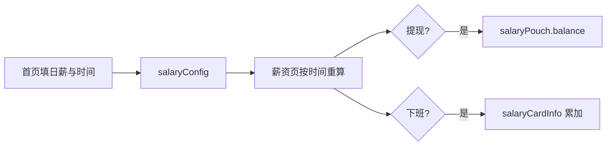

# main（小羊薪资记小程序工程）

按**日薪**和**固定上下班**算本班实时工资；**提现**进小金库，**下班**把袋内钱累进工资卡。配置和余额都在本机 `wx.setStorageSync` 里。

## 进度

**v1.1 已可用**：`pages/index` + `pages/salary`，组件 `vault-bag`、`salary-card`。计薪和下班入卡逻辑在 `pages/salary/salary.js`（文件头有中文注释）。

## 目录

```
main/
├── project.config.json
├── project.private.config.json
├── README.md
├── 代码阅读指南.md
└── miniprogram/
    ├── app.js / app.json / app.wxss / sitemap.json
    ├── pages/index/          工钱配置
    ├── pages/salary/         实时计薪、提现、下班
    └── components/
        ├── vault-bag/        牛皮纸袋
        └── salary-card/      工资卡展示
```

## 一条数据流



## 环境

- 微信开发者工具
- 无 npm、无云开发
- 真机 / 上传要有效 AppID（见 `project.config.json`）

## 读代码从哪入手

1. [`代码阅读指南.md`](代码阅读指南.md) — 地图和存储键  
2. `pages/index/index.js` — 校验、`onStartWork`、只清袋不清卡  
3. `pages/salary/salary.js` — 班次、计薪、提现、下班  

## 小提醒

- 导航栏：首页 `index.json` 是「小羊薪资记」；`app.json` 默认「工资计时器」——以页面自己的 `json` 为准。  
- 说明别写进 `.json`；写进对应 `.js`、`.wxml`、`.wxss` 或上面两份 md。
