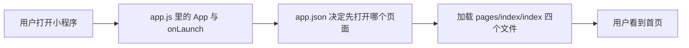

# 工资计时器小程序 — 零基础代码阅读指南

> 本文档对应目录：`salary_count/main`  
> 目标读者：**完全没写过代码** 也想看懂「这个项目在干什么、每个文件是干什么的」  
> 当前工程状态：第 1 步骨架已跑通，首页只显示标题，业务逻辑（计时、算工资）还没写。

---

## 一、先搞清楚：这是个什么东西？

**微信小程序**：运行在微信里的「小应用」，不用单独安装 App，在微信里搜名字或扫二维码就能打开。

**工资计时器**（规划中的功能）：你填入时薪、上班时间等，点「开始」后，屏幕上数字会跟着时间涨，让你实时看到「这段时间已经赚了多少钱」。

**你现在看到的代码**：相当于盖房子时打好的「地基 + 一间样板间」——能打开、能显示标题，但还没装计时器和计算功能。

---

## 二、用微信开发者工具怎么打开？

1. 安装 [微信开发者工具](https://developers.weixin.qq.com/miniprogram/dev/devtools/download.html)。
2. 选择「导入项目」，目录选本文件夹：`salary_count/main`（里面有 `project.config.json` 的那一层）。
3. 左侧是文件树，中间是预览，右侧/下方是控制台。改代码保存后，模拟器一般会刷新。

> **AppID**：在 `project.config.json` 里配置了小程序 ID，真机预览、上传需要你自己的小程序账号；本地模拟有时可以用测试号。

---

## 三、文件夹长什么样？（地图）

```
salary_count/main/
├── project.config.json      ← 给「开发者工具」看的配置（不是小程序运行时代码）
├── project.private.config.json  ← 本机私有配置（一般不用细看）
├── README.md                ← 项目简短说明
├── 代码阅读指南.md          ← 就是你正在看的这份文档
└── miniprogram/             ← ★ 小程序真正的源码都在这里
    ├── app.js               ← 整个小程序的「总入口」
    ├── app.json             ← 全局配置：有哪些页面、顶栏颜色等
    ├── app.wxss             ← 全局样式（所有页面共用的外观）
    ├── sitemap.json         ← 微信搜索/索引相关（现在几乎不用改）
    └── pages/
        └── index/           ← 「首页」这一个页面
            ├── index.js     ← 首页的逻辑与数据
            ├── index.json   ← 首页单独的配置
            ├── index.wxml   ← 首页长什么样（结构）
            └── index.wxss   ← 首页单独长什么样（样式）
```

**记住一条规则**：在微信小程序里，**一个页面通常由 4 个同名文件组成**（js / json / wxml / wxss），像拼图的四块，缺一块页面就不完整。

---

## 四、四种文件分别像什么？（类比表）

| 后缀 | 通俗理解 | 更接近网页里的什么 |
|------|----------|---------------------|
| **.js** | 大脑：数据、按钮点了之后发生什么 | JavaScript |
| **.wxml** | 骨架：页面上有哪些字、哪些盒子 | HTML |
| **.wxss** | 化妆：颜色、字号、边距、圆角 | CSS |
| **.json** | 小纸条配置：标题、引用组件等（**不能写注释**） | 配置文件 |

**数据怎么显示到屏幕上？**

1. 在 `index.js` 的 `data: { ... }` 里定义变量，例如 `title: '工资计时器'`。
2. 在 `index.wxml` 里用 **双花括号** 写 `{{title}}`，就会把值显示出来。
3. 如果以后要改显示内容，要用 `this.setData({ title: '新标题' })`，不能直接 `this.data.title = ...` 就指望界面自己变（这是小程序的规定）。

---

## 五、程序启动时谁先运行？（执行顺序）

可以理解成一条流水线：



1. 微信先加载 `app.json`，看到 `pages` 数组里第一项是 `pages/index/index`，所以**第一个打开的页面就是首页**。
2. 同时会执行 `app.js` 里的 `App({ ... })`，其中 `onLaunch()` 在小程序**每次冷启动**时执行一次（现在里面只有一行 `console.log`，在开发者工具「控制台」能看到）。
3. 然后加载首页的 js / wxml / wxss / json，拼出你看到的界面。

---

## 六、逐文件详解（带完整源码与白话注释）

下面每一节：**先讲作用 → 再给源码 → 再逐段解释**。

---

### 6.1 `miniprogram/app.js` — 整个小程序的总入口

**作用**：定义「这是一个小程序」，并在启动时做一次性初始化。还可以放 `globalData`，给所有页面共享的数据（例如以后放「用户设置的时薪」）。

**完整源码：**

```javascript
// app.js 是小程序的「总入口」，整个小程序启动时最先执行这里。
// 可以把它理解成整个程序的「大门」，进来的第一件事就是运行这个文件。

App({
    // onLaunch 是一个「生命周期函数」：小程序每次启动时会自动调用一次。
    // 我们暂时只在控制台打一行日志，用来确认它真的跑了。
    onLaunch() {
        console.log('小程序启动了');
    },

    // globalData 用来存放「所有页面都能用到的公共数据」。
    // 现在先放个名字，后面如果多个页面都要用同一份数据，就放这里。
    globalData: {
        appName: '工资计时器',
    },
});
```

**零基础释义：**

| 词汇 | 是什么意思 |
|------|----------------|
| `App({ ... })` | 微信提供的函数，告诉微信：「请把我的程序当成一个小程序来管理」。花括号里写各种设置和回调。 |
| `onLaunch` | 「刚启动时自动帮我做一件事」。现在做的事 = 在控制台打印「小程序启动了」，方便你调试时确认代码执行了。 |
| `console.log` | 把文字输出到开发者工具的「控制台」，用户在手机上看不到，程序员用来看调试信息。 |
| `globalData` | 全局储物柜。任何页面可以通过 `getApp().globalData.appName` 读到 `工资计时器` 这个名字（当前项目里还没在页面里用到）。 |

---

### 6.2 `miniprogram/app.json` — 全局配置（不能写 `//` 注释）

**作用**：微信官方规定的 JSON 格式，告诉微信：有哪些页面、窗口顶栏标题颜色、用哪份 sitemap 等。

**完整源码：**

```json
{
  "pages": [
    "pages/index/index"
  ],
  "window": {
    "navigationBarTitleText": "工资计时器",
    "navigationBarBackgroundColor": "#ffffff",
    "navigationBarTextStyle": "black",
    "backgroundColor": "#f5f7fa",
    "backgroundTextStyle": "light"
  },
  "style": "v2",
  "sitemapLocation": "sitemap.json",
  "lazyCodeLoading": "requiredComponents"
}
```

**字段白话：**

| 字段 | 含义 |
|------|------|
| `pages` | **页面路由表**，数组顺序很重要：**第一项 = 启动后默认打开的页面**。现在只有首页，所以一定是 `pages/index/index`（不要写 `.js` 后缀）。 |
| `window.navigationBarTitleText` | 顶部导航栏中间显示的文字。 |
| `navigationBarBackgroundColor` | 导航栏背景色，`#ffffff` 是白色。 |
| `navigationBarTextStyle` | 导航栏标题和返回箭头颜色，只能是 `black` 或 `white`。 |
| `backgroundColor` | 下拉刷新时露出的窗口背景色（和页面自己的背景可以一致）。 |
| `style: "v2"` | 使用新版基础组件样式。 |
| `sitemapLocation` | 指向 `sitemap.json` 的路径。 |
| `lazyCodeLoading` | 按需加载组件代码，减小首次加载体积（官方推荐配置）。 |

**以后要加「设置页」「历史记录页」**：在 `pages` 里多写一行路径，并新建 `pages/xxx/` 下四个文件即可。

---

### 6.3 `miniprogram/app.wxss` — 全局样式

**作用**：对所有页面都生效的 CSS 类规则。这里只设置了整个 `page` 根节点的背景色、文字颜色、字体。

**完整源码：**

```css
/* app.wxss 是「全局样式表」，这里写的样式对所有页面都生效。
   单个页面自己的样式写在页面目录下的 .wxss 里。

   WXSS 和网页的 CSS 很像，但单位常用 rpx：
   小程序规定屏幕宽度固定为 750rpx，所以 750rpx 就是「一整屏宽」。
   这样在不同手机上，界面比例会自动保持一致。 */

page {
    /* page 代表整个页面的根容器 */
    min-height: 100%;
    background: #f5f7fa;
    color: #1f2329;
    font-family: -apple-system, BlinkMacSystemFont, "Helvetica Neue", sans-serif;
}
```

**零基础释义：**

| 词汇 | 是什么意思 |
|------|----------------|
| `page { ... }` | 选中「整个页面」这个元素，给它统一样式。 |
| `rpx` | 响应式像素。本页首页卡片用 `48rpx` 等，会按屏幕宽度缩放。 |
| `min-height: 100%` | 高度至少铺满可视区域，避免内容少时下面露出奇怪底色。 |
| `font-family` | 字体列表，优先用系统自带的苹果/安卓黑体，看起来干净。 |

---

### 6.4 `miniprogram/pages/index/index.js` — 首页的「大脑」

**作用**：注册一个叫 `index` 的页面，并定义页面里的数据。当前没有按钮、没有函数，只有静态的 `data`。

**完整源码：**

```javascript
// 一个页面由 4 个文件组成，同名同目录：
//   index.js   —— 页面的「逻辑」：数据、按钮点击后干什么
//   index.wxml —— 页面的「结构」：屏幕上显示什么（类似网页的 HTML）
//   index.wxss —— 页面的「样式」：颜色、大小、间距（类似网页的 CSS）
//   index.json —— 页面的「配置」：标题栏文字等（注意：json 不能写注释）

Page({
    // data 是页面的「数据仓库」。
    // 这里定义的值，可以在 wxml 里用 {{名字}} 取出来显示。
    // 重要：想改变屏幕上显示的内容，必须通过 setData 修改 data，直接赋值页面不会更新。
    data: {
        title: '工资计时器',
        message: '工程已经跑通了',
    },
});
```

**零基础释义：**

| 词汇 | 是什么意思 |
|------|----------------|
| `Page({ ... })` | 和 `App` 类似，不过是**登记一个页面**。 |
| `data` | 页面上要展示或要计算用的数据都放在这里。现在两行字对应 wxml 里的 `{{title}}` 和 `{{message}}`。 |
| 将来加功能时 | 会在同文件里加 `onStartTap()` 之类的方法，用 `setInterval` 定时器每秒更新金额等——**当前还没写**。 |

---

### 6.5 `miniprogram/pages/index/index.wxml` — 首页的「长相结构」

**作用**：描述页面上有哪些容器、显示哪些文字。数据从 js 的 `data` 绑进来。

**完整源码：**

```xml
<!--
  wxml 是页面的「结构」，决定屏幕上显示什么。
  下面用到的几个基本标签：
    <view> 相当于一个「盒子」，用来装东西、排版（类似网页的 div）
    <text> 用来显示文字（类似网页的 span）

  {{ }} 是数据绑定：花括号里写 js 里 data 的名字，页面就会显示它的值。
  比如 {{title}} 会显示 data 里 title 的值「工资计时器」。
-->

<view class="page">
    <view class="card">
        <text class="title">{{title}}</text>
        <text class="desc">{{message}}</text>
    </view>
</view>
```

**结构示意图（嵌套关系）：**

```
.view.page          ← 整页外边距容器
  └── .view.card     ← 白色圆角卡片
        ├── .text.title  → 显示「工资计时器」
        └── .text.desc   → 显示「工程已经跑通了」
```

**零基础释义：**

| 词汇 | 是什么意思 |
|------|----------------|
| `class="page"` | 给这个盒子起名 `page`，方便在 wxss 里写 `.page { ... }` 来美化它。 |
| `{{title}}` | **数据绑定**：运行时会换成 js 里 `data.title` 的值。 |
| 注释 `<!-- ... -->` | 只给人看，不会出现在用户界面上。 |

---

### 6.6 `miniprogram/pages/index/index.wxss` — 首页的「化妆」

**作用**：只影响首页。把内容放在有内边距的页面里，中间一张白卡片，标题大字、说明小字灰色。

**完整源码：**

```css
/* 这是首页自己的样式，只影响首页，不会影响别的页面。

   写法规则：先写「选谁」，再用花括号写「怎么变样」。
   比如 .card { ... } 表示「class 叫 card 的那个盒子」。 */

.page {
    /* 整个页面的外框，留出四周空白，别让内容贴着屏幕边缘 */
    box-sizing: border-box;
    min-height: 100vh;
    padding: 48rpx 32rpx;
}

.card {
    /* 一张白色卡片 */
    box-sizing: border-box;
    display: flex;
    padding: 48rpx 36rpx;
    border: 2rpx solid #e5e8eb;
    border-radius: 24rpx;
    background: #ffffff;
    flex-direction: column; /* 让里面的文字上下排列 */
}

.title {
    color: #1f2329;
    font-size: 48rpx;
    font-weight: 700;
}

.desc {
    margin-top: 16rpx;
    color: #646a73;
    font-size: 28rpx;
}
```

**零基础释义：**

| 属性 | 视觉效果 |
|------|----------|
| `padding` | 内容与边框之间的「内边距」，让字不贴边。 |
| `border-radius` | 圆角，卡片看起来更柔和。 |
| `display: flex` + `flex-direction: column` | 弹性布局，子元素**竖着排**（标题在上、说明在下）。 |
| `font-weight: 700` | 粗体，标题更醒目。 |
| `100vh` | 视口高度的 100%（和 rpx 混用在这里表示「至少一屏高」）。 |

---

### 6.7 `miniprogram/pages/index/index.json` — 首页小配置

**作用**：可覆盖本页导航栏标题、引用自定义组件等。现在几乎用的是全局 `app.json` 的设置，这里再写一遍标题保持一致。

**完整源码：**

```json
{
  "navigationBarTitleText": "工资计时器",
  "usingComponents": {}
}
```

| 字段 | 含义 |
|------|------|
| `navigationBarTitleText` | 仅对本页生效的导航栏标题（与 app.json 相同则无视觉区别）。 |
| `usingComponents` | 空对象表示暂未引入任何自定义组件；以后用第三方 UI 组件会在这里注册。 |

---

### 6.8 `miniprogram/sitemap.json` — 搜索收录规则

**作用**：告诉微信爬虫哪些页面允许被索引。个人工具类小程序通常保持默认即可。

**完整源码：**

```json
{
  "desc": "关于本文件的更多信息，请参考文档 https://developers.weixin.qq.com/miniprogram/dev/framework/sitemap.html",
  "rules": [
    {
      "action": "allow",
      "page": "*"
    }
  ]
}
```

| 字段 | 含义 |
|------|------|
| `action: "allow"` | 允许被收录。 |
| `page: "*"` | 对所有页面生效。 |

---

### 6.9 `project.config.json` — 开发者工具工程配置（摘要）

**作用**：**不参与**用户手机上的业务逻辑，只影响你电脑上的微信开发者工具如何编译、用什么 AppID。

你只需要知道几项：

| 字段 | 含义 |
|------|------|
| `miniprogramRoot` | 值为 `miniprogram/`，表示源码子目录名。 |
| `appid` | 绑定的小程序 AppID，上传、真机调试要用。 |
| `projectname` | 工程显示名称（工具里看到的名字）。 |
| `libVersion` | 使用的基础库版本，影响能用什么 API。 |
| `setting.es6` | 是否把现代 JS 语法编译成兼容写法。 |
| `packOptions.ignore` | 打包时忽略 `README.md` 等，减小上传体积。 |

其余 `setting` 里大量布尔开关是编译优化、代码检查等，**初学阶段不用逐个改**。

---

## 七、三个文件之间的「连线关系」（首页）

读懂项目最重要的是知道 **js / wxml / wxss 怎么配合**：

```
index.js  data.title  ──────►  index.wxml  {{title}}  ──► 用户看到「工资计时器」
              │                        │
              │                        └── class="title"
              │                                  │
              └──────────────────────────────────▼
                                    index.wxss  .title { font-size: 48rpx; ... }
```

- **js** 提供文字内容（`data`）。
- **wxml** 决定放在哪、用什么标签、绑定哪个变量。
- **wxss** 决定字多大、什么颜色、卡片有没有圆角。

`app.json` 的 `pages` 决定微信去加载哪一组这四个文件。

---

## 八、和「工资计时」相关的功能，代码里现在有什么？

| 规划功能 | 当前代码里有没有 |
|----------|------------------|
| 设置时薪、上班时间 | ❌ 还没有 |
| 开始/暂停计时 | ❌ 还没有 |
| 实时滚动金额 | ❌ 还没有 |
| 本地保存记录（`wx.setStorageSync`） | ❌ 还没有（README 里写了计划用） |
| 能打开小程序、看到标题和「工程已经跑通了」 | ✅ 有 |

所以你现在读代码，重点学的是：**小程序最小骨架怎么搭**，而不是计时算法本身。

---

## 九、以后加功能时，一般会动哪些文件？（预习）

不用现在会做，有个印象即可：

1. **`index.wxml`**：加按钮（如 `<button bindtap="onStart">开始</button>`）、加显示金额的 `<text>`。
2. **`index.js`**：在 `data` 里加 `salary`、`amount` 等；写 `onStart` 函数；用 `setInterval` 定时 `setData` 更新金额。
3. **`index.wxss`**：给按钮、大数字金额加样式。
4. **可选新页面** `pages/settings/`：专门做设置页，并在 `app.json` 的 `pages` 里注册。
5. **`app.js` 的 `globalData` 或本地存储**：保存用户上次填的时薪，下次打开不用重填。

---

## 十、常见名词小词典（复习用）

- **小程序 / Mini Program**：运行在微信内的轻量应用。
- **页面（Page）**：用户看到的一屏界面，由 js+json+wxml+wxss 组成。
- **组件**：微信内置的标签，如 `view`、`text`、`button`、`input`。
- **绑定 `bindtap`**：点击时调用 js 里同名函数（以后写按钮会用到）。
- **setData**：更新 `data` 并刷新界面，小程序核心 API。
- **rpx**：按屏幕宽度自适应的长度单位。
- **生命周期**：如 `onLaunch`（应用启动）、`onLoad`（某页第一次加载，本页尚未使用）。

---

## 十一、推荐阅读顺序（配合本仓库源码）

1. 打开 `app.json`，看有几个页面、标题叫什么。  
2. 打开 `index.wxml`，对照模拟器看每一块对应哪里。  
3. 打开 `index.js` 的 `data`，改 `message` 几个字，保存，看模拟器是否变化（体验 `setData` 之外静态 data 的绑定）。  
4. 打开 `index.wxss`，把 `.card` 的 `background` 改成浅蓝色，感受样式如何生效。  
5. 打开 `app.js`，看控制台是否出现「小程序启动了」。  

---

## 十二、文档与源码注释的关系

- 项目约定：**`.json` 不能写注释**，所以 `app.json`、`index.json` 等的说明都写在本 MD 里。
- **`.js` / `.wxml` / `.wxss`** 里已有简短中文注释，方便在编辑器里边看边改。
- 本文件是**更长的「教科书版」说明**，适合从头到尾通读；改代码时以源文件为准。

---

*文档生成说明：与 `salary_count/main/miniprogram` 下当前源码一致。若你后续增加了计时、设置等逻辑，可把新文件按同样结构追加到本文「第六节」之后。*
