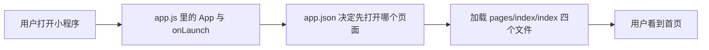

# 工资计时器小程序 — 零基础代码阅读指南

> 本文档对应目录：`salary_count/main`  
> 目标读者：**完全没写过代码** 也想看懂「这个项目在干什么、每个文件是干什么的」  
> 当前工程状态：第 1 步骨架已跑通，首页只显示标题，业务逻辑（计时、算工资）还没写。

---

## 一、先搞清楚：这是个什么东西？

**微信小程序**：运行在微信里的「小应用」，不用单独安装 App，在微信里搜名字或扫二维码就能打开。

**工资计时器**（规划中的功能）：你填入时薪、上班时间等，点「开始」后，屏幕上数字会跟着时间涨，让你实时看到「这段时间已经赚了多少钱」。

**你现在看到的代码**：相当于盖房子时打好的「地基 + 一间样板间」——能打开、能显示标题，但还没装计时器和计算功能。

---

## 二、用微信开发者工具怎么打开？

1. 安装 [微信开发者工具](https://developers.weixin.qq.com/miniprogram/dev/devtools/download.html)。
2. 选择「导入项目」，目录选本文件夹：`salary_count/main`（里面有 `project.config.json` 的那一层）。
3. 左侧是文件树，中间是预览，右侧/下方是控制台。改代码保存后，模拟器一般会刷新。

> **AppID**：在 `project.config.json` 里配置了小程序 ID，真机预览、上传需要你自己的小程序账号；本地模拟有时可以用测试号。

---

## 三、文件夹长什么样？（地图）

```
salary_count/main/
├── project.config.json      ← 给「开发者工具」看的配置（不是小程序运行时代码）
├── project.private.config.json  ← 本机私有配置（一般不用细看）
├── README.md                ← 项目简短说明
├── 代码阅读指南.md          ← 就是你正在看的这份文档
└── miniprogram/             ← ★ 小程序真正的源码都在这里
    ├── app.js               ← 整个小程序的「总入口」
    ├── app.json             ← 全局配置：有哪些页面、顶栏颜色等
    ├── app.wxss             ← 全局样式（所有页面共用的外观）
    ├── sitemap.json         ← 微信搜索/索引相关（现在几乎不用改）
    └── pages/
        └── index/           ← 「首页」这一个页面
            ├── index.js     ← 首页的逻辑与数据
            ├── index.json   ← 首页单独的配置
            ├── index.wxml   ← 首页长什么样（结构）
            └── index.wxss   ← 首页单独长什么样（样式）
```

**记住一条规则**：在微信小程序里，**一个页面通常由 4 个同名文件组成**（js / json / wxml / wxss），像拼图的四块，缺一块页面就不完整。

---

## 四、四种文件分别像什么？（类比表）

| 后缀 | 通俗理解 | 更接近网页里的什么 |
|------|----------|---------------------|
| **.js** | 大脑：数据、按钮点了之后发生什么 | JavaScript |
| **.wxml** | 骨架：页面上有哪些字、哪些盒子 | HTML |
| **.wxss** | 化妆：颜色、字号、边距、圆角 | CSS |
| **.json** | 小纸条配置：标题、引用组件等（**不能写注释**） | 配置文件 |

**数据怎么显示到屏幕上？**

1. 在 `index.js` 的 `data: { ... }` 里定义变量，例如 `title: '工资计时器'`。
2. 在 `index.wxml` 里用 **双花括号** 写 `{{title}}`，就会把值显示出来。
3. 如果以后要改显示内容，要用 `this.setData({ title: '新标题' })`，不能直接 `this.data.title = ...` 就指望界面自己变（这是小程序的规定）。

---

## 五、程序启动时谁先运行？（执行顺序）

可以理解成一条流水线：



1. 微信先加载 `app.json`，看到 `pages` 数组里第一项是 `pages/index/index`，所以**第一个打开的页面就是首页**。
2. 同时会执行 `app.js` 里的 `App({ ... })`，其中 `onLaunch()` 在小程序**每次冷启动**时执行一次（现在里面只有一行 `console.log`，在开发者工具「控制台」能看到）。
3. 然后加载首页的 js / wxml / wxss / json，拼出你看到的界面。
