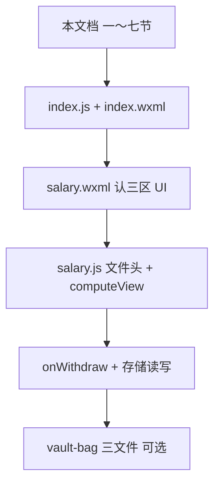

# 工资计时器小程序 — 代码阅读指南

> 对应目录：`salary_count/main`  
> 适用读者：想弄清「项目做什么、文件各干什么、先读哪份代码」的开发者（含零基础）  
> **当前状态：v1 已上线功能闭环**（输入 → 计薪 → 提现 → 本地持久化）

---

## 一、这是个什么东西？

**微信小程序**：在微信里运行的小应用，不需单独安装。

**小羊碎银记（工资计时器）**：

1. 首页填写**日薪**、**上班时间**、**下班时间**。
2. 点「上班」进入薪资页，根据**当前时间**自动判断未到上班 / 上班中 / 已下班。
3. **实时薪资**按班次时长线性计算；**提现**把当前实时金额累进小金库；牛皮纸袋显示累计余额。
4. 所有数据存在手机本地，不上传服务器。

---

## 二、用微信开发者工具打开

1. 安装 [微信开发者工具](https://developers.weixin.qq.com/miniprogram/dev/devtools/download.html)。
2. **导入项目**，目录选 **`salary_count/main`**（含 `project.config.json` 的一层）。
3. 保存代码后模拟器会刷新；逻辑日志可在控制台查看。

真机预览、上传需有效小程序 AppID（见 `project.config.json`）。

---

## 三、文件夹地图

```
salary_count/main/
├── project.config.json
├── README.md
├── 代码阅读指南.md          ← 本文档
└── miniprogram/
    ├── app.js               小程序入口
    ├── app.json             注册 pages/index、pages/salary
    ├── app.wxss             全局背景与字体
    ├── sitemap.json
    ├── pages/
    │   ├── index/           输入页（4 文件：js/json/wxml/wxss）
    │   └── salary/          薪资页（同上）
    └── components/
        └── vault-bag/       小金库展示组件（4 文件）
```

**约定**：一个页面（或组件）通常由 **js + json + wxml + wxss** 四个同名文件组成。

---

## 四、四种文件分工

| 后缀 | 作用 | 类比 |
| --- | --- | --- |
| **.js** | 数据、事件、计薪算法 | JavaScript |
| **.wxml** | 页面结构、数据绑定 `{{}}` | HTML |
| **.wxss** | 颜色、布局、字号 | CSS |
| **.json** | 标题、引用组件等（**不能写注释**） | 配置 |

界面要更新，须用 `this.setData({ ... })`，不要只改 `this.data` 指望界面自己变。

---

## 五、启动与页面跳转


1. `app.json` 的 `pages` 第一项是 `pages/index/index`，故**冷启动先进输入页**。
2. `app.js` 仅为 `App({})`，无全局 `globalData`。
3. 输入页校验通过后 `wx.setStorageSync('salaryConfig', ...)`，再 `wx.navigateTo` 到薪资页。
4. 薪资页若无配置会 toast 并 `navigateBack`。

---

## 六、两个页面各做什么？

### 输入页 `pages/index`

| 文件 | 关注点 |
| --- | --- |
| `index.wxml` | 日薪 `input`、时间 `picker`、「上班」按钮 |
| `index.js` | `onStartWork` 校验；写入 `salaryConfig` |
| `index.wxss` | 卡片、按钮；日薪框宽度在 wxml 用 `em` 随字数变化 |

`data` 里品牌名 `小羊碎银记` 显示在页头（与导航栏标题一致）。

### 薪资页 `pages/salary`

| 区域（wxml） | 含义 |
| --- | --- |
| `block-live` | 实时金额、状态胶囊、提现按钮 |
| `block-pouch` | `<vault-bag amount="...">` 小金库 |
| `block-progress` | 倒计时文案、进度条、「现在」～上班/下班时间 |

核心逻辑全在 **`salary.js`**（建议通读文件头注释后，按函数顺序看）。

### 组件 `components/vault-bag`

- 只接收属性 **`amount`**（已格式化的字符串，如 `"128.50"`）。
- 不参与计薪、不读写存储；结构为牛皮纸袋（木夹、卷口、便签「今日入账」）。

---

## 七、本地存了什么？

| 键名 | 写入位置 | 内容 |
| --- | --- | --- |
| `salaryConfig` | 输入页 | `{ dailySalary, startTime, endTime }`，`dailySalary` 为字符串 |
| `salaryPouch` | 薪资页提现 / 换班 | `{ balance, lastWithdrawAt, withdrawnThisShift, shiftKey }` |

- **`balance`**：累计已提现总额（跨班次保留）。
- **`withdrawnThisShift` / `lastWithdrawAt`**：本班已提现与上次提现时刻；**换班次**（`shiftKey` 变）时重置，但 `balance` 保留。
- 未到上班时，界面实时与小金库展示均为 **0.00**（`balance` 仍在本地，仅展示隐藏）。

---

## 八、计薪逻辑（读 `salary.js` 的顺序）

1. **`resolveShiftWindow`** — 把「HH:mm」转成当天的上班/下班 `Date`；支持夜班（下班 ≤ 上班则跨天）。
2. **`totalEarnedUntil`** — 截至此刻，本班应赚总额（线性，封顶日薪）。
3. **`liveEarnedSinceWithdraw`** — 自上次提现起至此刻应赚额（提现后实时从 0 再涨）。
4. **`computeView`** — 拼出界面需要的文案、倒计时、`phase`（before / working / after）、是否可提现。
5. **`refreshSalary`** — 每秒调用：用**当前时间戳重算**，不用定时器累加金额（防后台节流误差）。
6. **`onWithdraw`** — 把 `_liveAmount` 加进 `balance`，更新 `withdrawnThisShift` 与 `lastWithdrawAt`。

上班**前**的进度条：表示「等待上班」流逝比例，与上班中「已工作比例」含义不同（见 `refreshSalary` 注释）。

---

## 九、推荐阅读顺序



仓库级产品与问题记录见 **`salary_count/docs/开发日志.md`**。

---

## 十、常见问题（与代码无关的坑）

- **`.wxss` 勿带 UTF-8 BOM**，否则可能报 `unexpected � at pos 1`。
- **`app.json` 与 `index.json` 标题**不一致时，以页面 `json` 为准。
- 夜班在「下班～下次上班」之间的状态展示曾有产品歧义，见开发日志「已知问题」。

---

*文档随 v1 更新；若恢复多款式小金库或新增页面，请同步改 `app.json` 与本指南第三节地图。*
