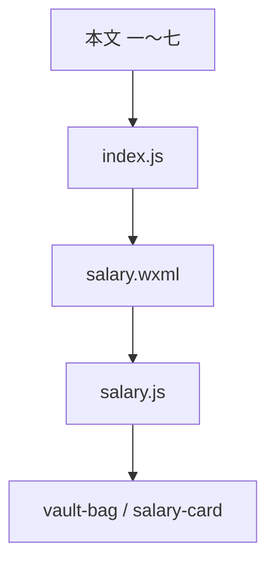

# 代码阅读指南（`salary_count/main`）

给想弄清「做什么、文件在哪、先读哪」的人看的，不要求会小程序也能顺着走一遍。

**功能闭环（v1.1）**：输入 → 计薪 → 提现 → 下班入卡 → 本地持久化。

---

## 一、这是啥

微信小程序，在微信里打开，不用单独安装。

**小羊薪资记**怎么用：

1. 首页填日薪、上班、下班时间。
2. 点「上班」进薪资页；页面按**当前时间**判断未到上班 / 上班中 / 已下班（没有手动「开始」按钮）。
3. **实时薪资**按班次线性涨；**提现**进小金库；**下班**把袋内钱累进工资卡（见 `salaryCardInfo`）。
4. 数据在手机上，不上传。

---

## 二、用开发者工具打开

1. 装 [微信开发者工具](https://developers.weixin.qq.com/miniprogram/dev/devtools/download.html)。
2. 导入 **`salary_count/main`**（含 `project.config.json` 的那一层）。
3. 改代码后模拟器会刷新；看逻辑用控制台。

真机、上传要有效 AppID（`project.config.json`）。

---

## 三、文件夹地图

```
salary_count/main/
├── project.config.json
├── README.md
├── 代码阅读指南.md          ← 本文
└── miniprogram/
    ├── app.js
    ├── app.json             index、settings、salary
    ├── app.wxss
    ├── sitemap.json
    ├── pages/
    │   ├── index/           输入（js/json/wxml/wxss）
    │   └── salary/          薪资（同上）
    ├── utils/
    │   └── cardStorage.js   工资卡读写
    └── components/
        ├── vault-bag/       小金库
        └── salary-card/     工资卡
```

一个页面或组件通常是 **js + json + wxml + wxss** 四个同名文件。

---

## 四、四种文件干啥

| 后缀 | 作用 |
| --- | --- |
| **.js** | 数据、事件、计薪 |
| **.wxml** | 结构、`{{}}` 绑定 |
| **.wxss** | 样式 |
| **.json** | 标题、组件引用（**不能写注释**） |

改界面要用 `this.setData`，只改 `this.data` 不会刷新视图。

---

## 五、谁先进来、怎么跳转


1. `pages` 第一项是 `index`，所以先见输入页。
2. `app.js` 是 `App({})`，没有 `globalData`。
3. 校验通过后写 `salaryConfig`，`navigateTo` 薪资页。
4. 薪资页没配置会 toast 后 `navigateBack`。

---

## 六、页面与组件

### 输入页 `pages/index`

| 文件 | 看啥 |
| --- | --- |
| `index.wxml` | 日薪、时间、`上班` |
| `index.js` | `onStartWork`、写配置、**只清袋**（不清工资卡） |
| `index.wxss` | 布局；日薪框宽度跟字数变 |

页头品牌 **`小羊薪资记`**（与 `index.json` 导航栏一致）。

### 薪资页 `pages/salary`

| 区域 | 含义 |
| --- | --- |
| `block-live` | 实时金额、状态、提现 |
| `block-pouch` | 小金库 + **下班**（在袋下方） |
| `block-card` | 工资卡（v1.1；若拆成独立页以 `app.json` 为准） |
| `block-progress` | 倒计时、进度条 |

逻辑集中在 **`salary.js`**，建议先读文件头注释，再按函数往下看。

### `vault-bag`

属性 **`amount`**，格式化字符串；不计薪、不碰存储。牛皮纸袋 + 便签「今日入账」；下班按钮通过事件通知父页面。

### `salary-card`

属性 **`amount`**，只展示；数据由页面 `loadCardIncome` / 下班后写入。

---

## 七、本地存了什么

| 键 | 谁写 | 内容 |
| --- | --- | --- |
| `salaryConfig` | 输入页 | `{ dailySalary, startTime, endTime }`，日薪用字符串 |
| `salaryPouch` | 薪资页 | `balance`、`lastWithdrawAt`、`withdrawnThisShift`、`shiftKey`、`clockedOutAt`；下班入卡后 `balance` 归零 |
| `salaryCardInfo` | 下班 | `amount`、`updateDate`、`todayCredited`、可选 `yesterday` |
| `salaryCardAmount` | 兼容 | 与 `amount` 同步 |

上班前：实时和袋**展示** 0.00，`balance` 可能还在本地。  
换班次：`shiftKey` 变时重置本班提现字段，袋余额规则见 `readPouchRecord`。

---

## 八、读 `salary.js` 的顺序

1. **`resolveShiftWindow`** — 夜班、跨天窗口  
2. **`totalEarnedUntil`** / **`liveEarnedSinceWithdraw`** — 线性计薪  
3. **`computeView`** — 界面文案、`phase`、能否提现/下班  
4. **`refreshSalary`** — 定时触发，用时间戳**重算**（不累加）  
5. **`onWithdraw`** / **`onClockOut`** / **`syncCardIncomeFromPouch`** — 提现、下班入卡  

上班前进度条表示「等上班过了多久」，和上班中「班内进度」不是同一回事。

---

## 九、推荐阅读顺序



产品与已知坑： **`docs/开发日志.md`**。

---

## 十、杂项

- `.wxss` 不要用 UTF-8 BOM，否则易报 `unexpected �`。  
- `app.json` 与页面 `json` 标题不一致时，以**页面**为准。  
- 夜班「下班～下次上班」之间状态曾和产品稿不一致，见开发日志。

---

*随 v1.1 更新；新增页面请改 `app.json` 并同步第三节地图。*
